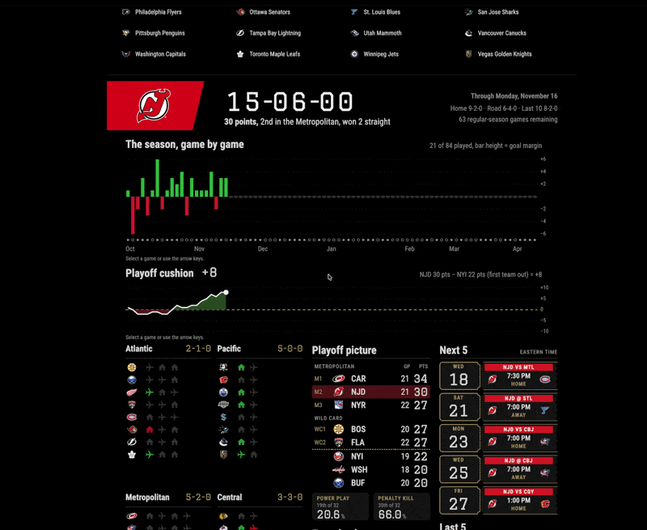

# Rinkside

A season at a glance for all 32 NHL teams: results, standings, playoff context, special teams, and player leaders in one shareable poster.

**[Open Rinkside](https://www.rinkside.xyz)** · **[New Jersey Devils demo](https://www.rinkside.xyz/team/NJD)**

[](https://www.rinkside.xyz/team/NJD)

Built for fun, with room to grow. The repository is still named `nhl-reddit-stats`.

## What’s inside

- **Team posters** with shareable `/team/{TEAM}` links, responsive layouts, and archived box scores.
- **Saved NHL data** with separate freshness and coverage for completed scores and supplemental team statistics.
- **Hockey history** with player, teammate, opponent, and Finals queries over a SQLite serving database.
- **An analyst and visualization toolkit** for data-backed answers, reviewed insights, and chart specifications.
- **Social previews** generated at build time for every team, using local fonts and logos.

## Run locally

Use **Bun 1.4.3** and **Node.js 24**. Python 3 is also needed for historical imports, database builds, and their tests. Run these commands from the repository root:

```sh
bun install --frozen-lockfile

# Terminal 1: serve the saved season data at http://127.0.0.1:3001
bun run data:serve

# Terminal 2: start the web app
bun run --cwd apps/web dev --hostname 127.0.0.1 --port 4173
```

Open [localhost:4173](http://127.0.0.1:4173). Next serves `/api` from the route handlers in `apps/web/app/api`. Team links such as `/team/NJD` open a poster directly; legacy `#team/NJD` links still work.

The season poster uses committed snapshots. History queries additionally need a serving database; start the API with `bun run data:serve --history /absolute/path/to/nhl-serve.sqlite` to enable `/api/history`. The build’s `history:fetch` task downloads and verifies the artifact referenced by `data/history/serving.json` when that pointer exists. A missing pointer is allowed, but history data is then unavailable unless supplied separately.

```sh
bun run build       # Build the workspaces; web output is apps/web/.next
bun run preview     # Build and serve the web production output
```

## Workspace map

Bun manages dependencies; Turborepo coordinates workspace tasks. Each workspace owns its implementation and scripts.

| Workspace | Responsibility |
| --- | --- |
| [`apps/web`](apps/web) | Next.js, React, and Tamagui application; XState interaction state; API route handlers and social cards |
| [`apps/api`](apps/api) | Effect HTTP/RPC server; snapshot, box-score, and history services |
| [`packages/season`](packages/season) | Shared season schemas, calculations, and RPC contracts |
| [`packages/history`](packages/history) | History contracts, graph algorithms, and query interfaces |
| [`packages/analyst`](packages/analyst) | Effect and AI SDK analyst, read-only DuckDB queries, insight workflows, and evaluations |
| [`packages/viz`](packages/viz) | Visualization contracts, table projections, samples, and view-code checks |

The API’s services are composed with Effect Layers. Local Node and Vercel entrypoints share the route implementations while supplying different storage adapters. The browser consumes shared contracts; server implementation stays behind the API boundary. See the [API guide](apps/api/README.md) for transport, cancellation, and deployment packaging details.

## Data and refreshes

The API serves saved data; opening a team poster does not fetch fresh NHL feeds. Refresh explicitly:

```sh
bun run data:refresh:all
```

Completed scores and box scores can advance while delayed supplemental feeds retain their last validated values. Retained statistics preserve their original timestamps and game coverage. Restart the local API after refreshing; production snapshot changes require a rebuild and deployment.

The [data guide](data/README.md) covers sources, validation, box-score archiving, and refresh options. The [season refresh workflow](.github/workflows/refresh-nhl-data.yml) and [history refresh workflow](.github/workflows/refresh-nhl-history.yml) own scheduled automation; their presence does not imply that scheduled collection is enabled.

Historical ingestion and serving-database builds live in [`scripts`](scripts). The [history plan](docs/nhl-teammate-graph-plan.md) records the data model and acceptance gates; the [TypeScript port plan](docs/nhl-history-typescript-port-plan.md) tracks planned migration work.

## Engineering guardrails

[AGENTS.md](AGENTS.md) is the detailed working agreement and enforcement map. These are the main rules contributors should know:

| Area | Rule and source of enforcement |
| --- | --- |
| Typed failures | Expected failures use branded `Schema.TaggedError` values with context; foreign causes are preserved. The [error-model check](scripts/check-error-model.mjs) and Effect diagnostics enforce this in adopted scopes. |
| JSON boundaries | Decode external values with schemas and pass typed values inward. JSON and `unknown` checks apply according to the workspace coverage in [AGENTS.md](AGENTS.md). |
| Union models | Define tagged unions once, construct members through schemas or enums, and handle every case. The [union plugin](lint/union-model-plugin.mjs) and anti-slop rules check these patterns. |
| Effect idioms | Use Effect core and platform services where required. [Core rules](lint/effect-core.oxlintrc.json), [Node-script rules](lint/node-scripts.oxlintrc.json), and API-index checks guard adopted code. |
| UI and state | The [design contract](apps/web/design/README.md) owns semantic colors, spacing, typography, and geometry. Web lint also checks actor ownership and XState transition/action purity. |
| Changed-code checks | All six workspaces extend the [anti-slop configuration](lint/anti-slop.oxlintrc.json). Its configurable rules check changed lines by default; `ANTI_SLOP_MODE=all bun run lint` audits existing code too. |
| Secrets | Variables are declared in [`.env.schema`](.env.schema); real values stay in ignored local configuration. `bun run env:check` validates resolution without printing sensitive values. Live analyst commands use Varlock. |

Enforcement is incremental: package and file coverage differ, and some existing findings remain warnings. The exact scopes and exceptions belong in [AGENTS.md](AGENTS.md) and the linked configurations. Do not disable checks to make a change pass.

Before changing a library integration, use the [local source guide](.agent-sources/README.md) and installed declarations. Non-trivial implementation follows the [project Ratstack workflow](.agent-sources/ratstack/README.md).

## Validation

Run the root checks for code changes:

```sh
bun run typecheck   # All six workspaces, using Effect-aware TSRS
bun run lint        # Typed lint, boundary checks, and rule fixtures
```

For web UI changes, also run `bun run check:tamagui`. Use `bun run build` to validate production output. Tests are selected by workspace or concern; there is no root `test` script:

| Concern | Command |
| --- | --- |
| Season snapshots and HTTP data behavior | `bun run test:data` |
| API and RPC behavior | `bun run test:api` |
| Python history pipeline | `bun run test:history` |
| History package | `bun run --cwd packages/history test` |
| Analyst and evaluation behavior | `bun run --cwd packages/analyst test` |
| Visualization contracts | `bun run --cwd packages/viz test` |
| Team selection and box scores | `bun run --cwd apps/web test:teams` |
| Social cards and metadata | `bun run --cwd apps/web test:social` |
| Analyst plan parsing | `bun run --cwd apps/web test:plan` |

GitHub Actions provides partial CI coverage: [workspace checks](.github/workflows/workspace-checks.yml) always parse the plan and conditionally test analyst/web changes; [history checks](.github/workflows/history-checks.yml) run the history/API and related checks for matching paths. Run the local gates for your change even when CI does not select them.

## Social previews and assets

Each web build generates 1200×630 PNG cards and HTML metadata for all 32 team URLs. Cards use saved statistics, local fonts and logos, and content-hashed image URLs. Refresh the snapshots and rebuild to update them; social platforms may still cache metadata.

Set `SITE_URL=https://www.rinkside.xyz` for the canonical production origin. Otherwise the build falls back to Vercel’s production URL, deployment URL, then `http://localhost:3000`. Preview deployments use their own URL for image assets.

- [Social card layout](apps/web/social/card.ts), [crawler metadata](apps/web/social/metadata.ts), and [PNG route](apps/web/app/og/%5Bimage%5D/route.ts)
- [Asset sources and licenses](apps/web/public/assets/SOURCES.md)
- [Design comparison notes](design-qa.md)

Tamagui configuration lives in [`apps/web/tamagui.config.ts`](apps/web/tamagui.config.ts), with compiler options in [`apps/web/tamagui.build.ts`](apps/web/tamagui.build.ts). The Tamagui Next plugin handles compilation. After configuration changes, run `bun run generate:tamagui` to refresh the local prompt reference.

## Credits

Inspired by [the original r/devils Reddit post](https://www.reddit.com/r/devils/s/jmn4emEiez). Hockey data comes from the NHL sources recorded in the snapshots and data guide.
